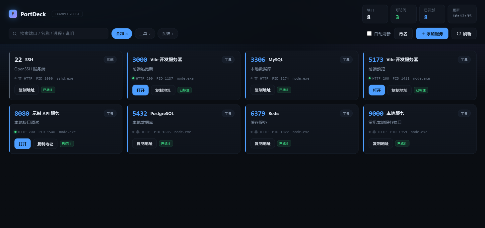

# PortDeck

本机端口总控台 — 一眼看清这台机器上每个端口在干什么，并且能直接点开。



## 它解决什么问题

开发机上跑着十几个服务：模型网关、代理中转、MCP 服务、开发服务器、数据库……过两天就忘了哪个端口是什么。`netstat` 只给端口号和 PID，`任务管理器` 只给进程不给端口。

PortDeck 把两边拼起来，加上**用途说明**和**一键打开**。

## 特性

- **自动发现** — 扫描所有监听端口，关联到具体进程（PID / 进程名 / 完整命令行）
- **自动识别用途** — 内置规则库按进程名、命令行关键字、端口区间推断这是什么服务，不用手写
- **HTTP 探测** — 自动判断哪些端口是 HTTP 服务，抓页面标题，能直接点开
- **手动标注优先** — 自己写的说明永远覆盖自动识别，改 `ports.json` 立即生效
- **网页里管理服务** — 顶栏「＋ 添加服务」新增，卡片「编辑 / 标注」改名，「删除此标注」移除，不用再手改 JSON
- **控制台改名** — 顶栏「改名」修改页面标题与左上角名称，保存在 `ports.json` 的 `appName`
- **未运行也显示** — 添加时勾选后，端口当前没监听也会以「未运行」卡片列出
- **分类筛选 + 搜索** — 按类别（模型 / 代理 / 工具 / 系统 / 应用）过滤，支持端口号、名称、进程、说明全文搜索
- **自动刷新** — 可选每 10 秒重扫
- **零依赖** — 只用 Node 内置模块，不需要 `npm install`

## 快速开始

```bash
node server.js
```

打开 http://127.0.0.1:4999

环境变量：

| 变量 | 默认 | 说明 |
|---|---|---|
| `PORTDECK_PORT` | `4999` | 监听端口 |
| `PORTDECK_HOST` | `127.0.0.1` | 监听地址，改成 `0.0.0.0` 可局域网访问 |

## 配置

配置分两层：**仓库里的通用示例** + **你自己的本机配置（不进 Git）**。

| 文件 | 进 Git？ | 用途 |
|---|---|---|
| `ports.example.json` / `rules.example.json` | 是 | 通用示例，可直接改名使用 |
| `ports.local.json` | 否（`.gitignore`） | 你的真实标注和控制台名称 |
| `rules.local.json` | 否（`.gitignore`） | 本机专属识别规则，和示例规则合并、本机优先 |

开始使用：把 `ports.example.json` 复制为 `ports.local.json`（或直接在网页上添加服务，会自动生成它）。`rules.local.json` 可选。

### `ports.json` — 手动标注（优先级最高）

```json
{
  "version": 1,
  "appName": "我的端口台",
  "ports": [
    {
      "port": 3425,
      "name": "模型网关",
      "cat": "模型",
      "note": "统一模型网关（OpenAI 协议）",
      "url": "http://127.0.0.1:3425/v1/models",
      "showWhenOffline": false
    }
  ]
}
```

字段：

| 字段 | 说明 |
|---|---|
| `appName` | 控制台显示名称（页面标题 / 左上角），缺省 `PortDeck` |
| `port` | 端口号 |
| `name` | 显示名称 |
| `cat` | 分类：`模型` / `代理` / `工具` / `系统` / `应用` / `其他` |
| `note` | 用途说明 |
| `url` | 点「打开」跳转的地址，留空则不显示按钮 |
| `showWhenOffline` | 可选。`true` 时端口未监听也显示「未运行」卡片 |

也可以在网页上完成同样的事：

| 按钮 | 作用 |
|---|---|
| 顶栏「改名」 | 修改 `appName`，刷新后仍生效 |
| 顶栏「＋ 添加服务」 | 新增一条手动标注；端口重复会报 409 |
| 卡片「编辑」/「标注」 | **任何端口都能标注**：手动标注直接改；自动识别的端口保存后自动升级为手动标注（upsert） |
| 弹窗「删除此标注」 | 删掉这条手动标注，端口会退回自动识别 |

写接口（默认只监听 `127.0.0.1`，拒绝跨站 Origin；若把 `PORTDECK_HOST` 改成 `0.0.0.0`，同一局域网内的机器也能读写这些接口，请自行加访问控制）：

| 方法 | 路径 | 说明 |
|---|---|---|
| `GET` | `/api/services` | 读取 `appName` 与全部手动标注 |
| `POST` | `/api/services` | 新增服务 |
| `PUT` | `/api/services/:port` | 修改服务（含改端口、改名） |
| `DELETE` | `/api/services/:port` | 删除手动标注 |
| `PUT` | `/api/settings` | 修改控制台名称 `{ "appName": "新名字" }` |

所有写操作走临时文件 + 原子替换，并且串行排队，不会把配置文件写坏。网页上的改动只写入你的本机配置（`ports.local.json`），不会碰仓库里的示例文件。

### `rules.json` — 自动识别规则

```json
{
  "processRules": [
    { "field": "cmd", "match": "vite", "name": "Vite 开发服务器", "cat": "工具", "note": "前端热更新" }
  ],
  "portRules": [
    { "range": [3000, 3999], "name": "开发服务", "cat": "工具", "note": "常见开发端口" }
  ]
}
```

匹配顺序：**手动标注 → 端口区间规则 → 命令行关键字 → 进程名**。

`processRules` 的 `field` 可以是 `proc`（进程名）或 `cmd`（完整命令行），`type` 设为 `regex` 时 `match` 按正则解析。

`rules.local.json` 里的规则会和示例规则**合并加载，本机规则排在前面（优先命中）**，适合放你自己服务的关键字。

## 开机自启（Windows）

仓库里带了 `supervise.ps1` + `start-hidden.vbs`，配合计划任务实现开机启动和崩溃自愈：

```powershell
$action = New-ScheduledTaskAction -Execute "C:\Windows\System32\wscript.exe" `
  -Argument '//nologo "<仓库路径>\start-hidden.vbs"'
$t1 = New-ScheduledTaskTrigger -AtLogOn -User "$env:USERNAME"
$t2 = New-ScheduledTaskTrigger -Once -At (Get-Date).AddMinutes(3) `
  -RepetitionInterval (New-TimeSpan -Minutes 5) -RepetitionDuration (New-TimeSpan -Days 3650)
$settings = New-ScheduledTaskSettingsSet -StartWhenAvailable `
  -RestartCount 3 -RestartInterval (New-TimeSpan -Minutes 1) `
  -MultipleInstances IgnoreNew -ExecutionTimeLimit ([TimeSpan]::Zero)
Register-ScheduledTask -TaskName "PortDeck" -Action $action -Trigger $t1,$t2 `
  -Settings $settings -Force
```

`supervise.ps1` 每 5 秒检查端口，挂了就重新拉起；脚本自带单实例守卫，健康检查重复触发不会起第二个。

## 平台支持

目前只有 **Windows** 采集器（`netstat -ano` + PowerShell `Get-CimInstance`）。

Linux / macOS 需要在 `server.js` 的 `scanPorts()` 里换实现（`ss -tlnp` 或 `lsof -iTCP -sTCP:LISTEN`），前端和规则库可以直接复用。欢迎 PR。

## 识别机制

按精确度从高到低依次尝试，第一个命中的生效：

| 顺序 | 手段 | 例子 |
|---|---|---|
| 1 | 命令行关键字 | `vite` → Vite 开发服务器 |
| 2 | 进程名 | `sshd.exe` → SSH |
| 3 | HTTP 响应头 | `server: uvicorn` → FastAPI 服务 |
| 4 | TCP banner | `SSH-2.0-OpenSSH` → SSH |
| 5 | 已知端口库 | `3306` → MySQL |
| 6 | Windows 服务名 | `TermService` → RDP |
| 7 | 可执行文件元数据 | `ProductName` → 对应软件名 |
| 8 | 端口区间（兜底） | `3000-3999` → 开发服务 |

端口区间放最后，因为它最粗 —— `3000-3999` 会把 `3425` 这种模型网关也吞成「开发服务」。

## 性能

实测 59 个端口全量扫描 **2.9 秒**：

| 阶段 | 耗时 | 说明 |
|---|---|---|
| 端口采集 | 59 ms | `netstat -ano`（`Get-NetTCPConnection` 要 2100ms） |
| 进程/服务索引 | 900 ms | 一次性全量查询，不是每端口查一次 |
| HTTP + banner 探测 | ~1.9 s | 32 路并发，HTTP 800ms / banner 400ms 超时 |

两个关键优化：

1. **用 `netstat -ano` 而不是 `Get-NetTCPConnection`** —— 后者是 WMI 封装，慢 35 倍
2. **进程和服务一次性全量取，建索引查表** —— 逐端口查询会退化成 N 次 WMI 往返（59 端口 = 37 秒）

## 技术栈

- 后端：Node.js 内置 `http` / `child_process` / `os` / `net`，无第三方依赖
- 前端：原生 HTML + CSS + JS，单文件，无构建步骤
- 采集：`netstat -ano` + PowerShell `Get-CimInstance`（进程 / 服务 / 版本信息）

## License

MIT
